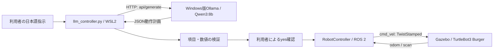

# 大規模言語モデルを活用した自然言語による移動ロボット制御

日本語の移動指示をローカルLLM（Qwen3:8b）でJSON形式の動作計画に変換し、ROS 2を経由してGazebo内のTurtleBot3 Burgerを操作する、Physical AI最終課題のプロジェクトです。

生成された計画をPythonで検証し、利用者が確認画面で`yes`と入力した場合だけ実行します。前進中はLiDARで前方の障害物を監視し、所定の距離より近づくと動作を中断します。

## システム構成



詳しい制御、トピック、QoS、停止処理は[システム構成資料](docs/architecture.md)を参照してください。

## 使用技術・開発環境

| 項目 | 開発・デモ環境 |
| --- | --- |
| ホストOS | Windows 11 |
| Linux | WSL2 / Ubuntu 24.04 |
| ROS 2 | Jazzy |
| シミュレータ | Gazebo Sim 8系（Harmonic） |
| ロボット | TurtleBot3 Burger |
| 言語 | Python 3（今回の検査環境: 3.12.3） |
| LLM実行環境 | Windows版Ollama |
| LLM | `qwen3:8b` |
| HTTP通信 | Python標準ライブラリ`urllib.request` |
| ROS依存 | `rclpy`、`geometry_msgs`、`nav_msgs`、`sensor_msgs` |

ROS 2、Gazebo、TurtleBot3関連パッケージと、ビルド済みの`~/turtlebot3_ws`を前提とします。このリポジトリにロボットモデル、Gazeboワールド、ROSワークスペース、LLMの重みは含みません。別の場所にインストールした場合は、以下のワークスペースのパスを読み替えてください。

初期構築は[ROS 2 Jazzyのインストール資料](https://docs.ros.org/en/jazzy/Installation/Ubuntu-Install-Debs.html)、[ROBOTISのセットアップ資料](https://emanual.robotis.com/docs/en/platform/turtlebot3/quick-start/)、[シミュレーション資料](https://emanual.robotis.com/docs/en/platform/turtlebot3/simulation/)を参照してください。TurtleBot3の資料ではJazzy向けの手順を選択してください。

`requirements.txt`はコメントのみです。追加のpip依存はなく、ROSのPythonモジュールはROS環境から読み込みます。`pip install rclpy`での代用は想定していません。

## 実装した機能

- 日本語の指示から、最大5動作のJSON計画を生成。
- 前進距離、旋回角度、動作種別、各動作のキー、数値の型と有限性を検証。
- 計画を表示し、`yes`による確認後に順番に実行。
- オドメトリによる移動距離・旋回角度の計測。
- 前進開始前のLiDAR取得待ちと、前進中の前方障害物検知による停止。
- 制御ループ終了時のゼロ速度送信と、通常の終了経路でのノード破棄・ROS終了処理。


## 実行手順

### 1. Windows版Ollamaの準備と通信確認

Windows側でOllamaを起動し、PowerShellでモデルを確認します。未取得の場合だけダウンロードしてください。

```powershell
ollama list
# qwen3:8bがない場合
ollama pull qwen3:8b
```

ソース内の接続先は`http://127.0.0.1:11434/api/generate`、モデル名は`qwen3:8b`です。APIキーは使用していません。`OLLAMA_URL`と`MODEL`は`llm_controller.py`の定数で、環境変数による上書きには対応していません。モデルの保存場所はWindows側Ollamaの設定に依存し、このコードは保存先を直接参照しません。

今回確認したWSL2のネットワーク方式は`mirrored`です。Microsoftの資料では、この方式でWindowsとWSL2の間を`127.0.0.1`で通信できるとされています。NAT方式の環境では、同じURLでWindows版Ollamaへ到達できるとは限りません。[WSLネットワークの公式説明](https://learn.microsoft.com/en-us/windows/wsl/networking)を参照してください。

WSL側で、推論やロボット操作を伴わない疎通確認を行います。

```bash
wslinfo --networking-mode
curl --fail --silent --show-error --max-time 5 http://127.0.0.1:11434/api/tags
```

`wslinfo`が利用できない場合は、Windows側のWSL設定とバージョンを確認してください。今回の確認ではAPIに接続でき、モデル一覧に`qwen3:8b`が存在しました。推論APIの実呼び出しは今回の検査では行っていません。

接続できない場合は、Windows側Ollamaの起動状態、WSLのネットワーク方式、プロキシ設定を確認してください。現在のローカル接続を前提とし、この手順ではOllamaのLAN公開やファイアウォールの変更は行いません。

### 2. ROS 2環境の設定

Gazebo用とコントローラ用の**両方のWSLターミナル**で、次を実行します。

```bash
source /opt/ros/jazzy/setup.bash
source ~/turtlebot3_ws/install/setup.bash
export ROS_AUTOMATIC_DISCOVERY_RANGE=LOCALHOST
export TURTLEBOT3_MODEL=burger
```

`ROS_DOMAIN_ID`を設定している場合は、両方のターミナルで同じ値に揃えてください。探索範囲の設定はROS 2用で、OllamaのHTTP通信設定とは別です。

### 3. Gazeboの起動

1つ目のターミナルで起動します。インストール済みワークスペースに、このlaunchファイルとBurger用ブリッジ設定が存在することを確認しています。

```bash
ros2 launch turtlebot3_gazebo turtlebot3_world.launch.py
```

Gazeboにロボットが表示され、シミュレーションが再生中であることを確認してください。提出デモで使用した障害物の配置はこのリポジトリには保存されていないため、起動だけで同じ実験条件になるとは限りません。

### 4. トピック確認と起動

2つ目のターミナルでROS環境を設定した後、型と購読・配信状況を確認します。

```bash
ros2 topic info /cmd_vel --verbose
ros2 topic info /odom --verbose
ros2 topic info /scan --verbose
```

必要な型は、`/cmd_vel`が`geometry_msgs/msg/TwistStamped`、`/odom`が`nav_msgs/msg/Odometry`、`/scan`が`sensor_msgs/msg/LaserScan`です。`Twist`だけを受け取る設定とは互換性がありません。

```bash
cd ~/physical_ai
python3 llm_controller.py
```

指示を入力して生成された計画を確認し、実行する場合は`yes`を入力します。前後の空白と英字の大小は無視されます。それ以外の入力では実行せず終了します。1回の起動で1つの指示を受け付けます。

前進中の障害物検知やタイムアウトでは、残りの動作も中断します。実行中の`Ctrl+C`にも停止送信を試みますが、強制終了や通信障害を含むすべての状況で停止を保証する実装ではありません。

`python3 robot_controller.py`は確認入力なしで固定の「0.5m前進→右90度→0.3m前進」を実行する直接テスト用入口です。通常の自然言語操作では`llm_controller.py`を使用してください。

## 自然言語指示とJSONの例

```text
50cm前進して、右に90度回って、30cm進んで
1m前進して
左に90度回って
```

最初の指示に対応する計画例です。LLMの出力は毎回同じになるとは限りません。

```json
{
  "actions": [
    {"type": "move", "distance": 0.5},
    {"type": "turn", "angle": -90},
    {"type": "move", "distance": 0.3}
  ]
}
```

| 動作 | 受理する値 | 意味 |
| --- | --- | --- |
| `move` | `distance`: 0.05〜1.0 | メートル単位の前進 |
| `turn` | `angle`: −180〜−1、1〜180 | 度単位。正が左、負が右 |

0度の旋回、1度未満の旋回、後退、6動作以上には対応していません。値は文字列や真偽値ではなく、有限な数値である必要があります。対応できない指示には空配列を返すようLLMに指示しますが、空配列は検証段階で拒否され、実行されません。LLMのプロンプト上の角度範囲と異なり、コードでは絶対値1度未満を拒否します。

## LiDARによる安全停止

`/scan`をROS 2の`qos_profile_sensor_data`（Best Effort、Volatile、Keep Last・深さ5）で購読します。スキャン角度を正面基準に正規化し、正面±15度の有限かつ正の距離の最小値を使用します。

- 前進開始前に、位置情報と有効な前方距離をそれぞれ最大5秒待ちます。
- 前進ループでは、前方距離が**0.30m未満**なら例外で中断し、ゼロ速度を送信します。
- 正面に有効な測距値がなくなった場合も中断します。全値が無限大のスキャンも有効値なしとして扱います。
- 旋回中の障害物停止や、側面・後方の監視は実装していません。
- 受信時刻の監視はないため、スキャン配信が途絶しても最後の有効値が残る場合があります。

これは前方監視を中心とした簡易的な停止機能です。全方向の衝突回避や実機での安全性を保証するものではありません。

## 動作確認の状況

課題作成者による確認では、次の2つのGazeboデモが完了し、動画も撮影・編集済みです。動画ファイルはこのリポジトリには含めていません。

| デモ | 指示・条件 | 作成者による確認結果 |
| --- | --- | --- |
| 自然言語操作 | 「50cm前進して、右に90度回って、30cm進んで」 | JSON生成後に前進・右旋回・前進を実行 |
| 前方障害物検知 | 障害物のある環境で「1m前進して」 | 障害物に接触する前に停止 |

今回の公開準備ではGazeboを起動せず、走行デモも再実行していません。実施した検査と未検証項目は[公開準備・コード確認報告](docs/publication_review.md)を参照してください。

## 制約事項

- 後退、経路探索、地図作成、自動迂回、目標座標へのナビゲーションは未実装です。
- LLMは指示の意味を誤解する可能性があります。数値検証は意味の正しさを保証しないため、実行前に計画を確認してください。
- 動作は最大5個で、各動作の実行タイムアウトは20秒です。
- オドメトリとLiDARの更新途絶を受信時刻で判定しません。オドメトリの誤差にも影響されます。
- LiDARの`range_min`・`range_max`は判定に使いません。
- 時間制限には実時間の`time.monotonic()`を使用し、Gazeboの一時停止中でも時間が進みます。
- 終了時には停止送信を試みますが、ROSコンテキスト終了後などに送信自体が失敗すると、後続の終了処理が実行されない可能性があります。
- Windows版OllamaとWSL2の通信、およびROSトピックの型・QoSが環境と一致している必要があります。

## 今後の改善点

- LiDARとオドメトリの受信時刻監視、測距範囲の検証。
- 停止送信に失敗してもノード破棄・ROS終了を試みる終了処理の改善。
- API接続先とモデル名の設定可能化、APIエラーの種類に応じた表示。
- 空の計画、0度旋回などに関するプロンプトと検証仕様の統一。
- 制御の回帰テストと、障害物配置を含む実験条件の保存。
- 後退・全方向監視・経路計画の検討。

